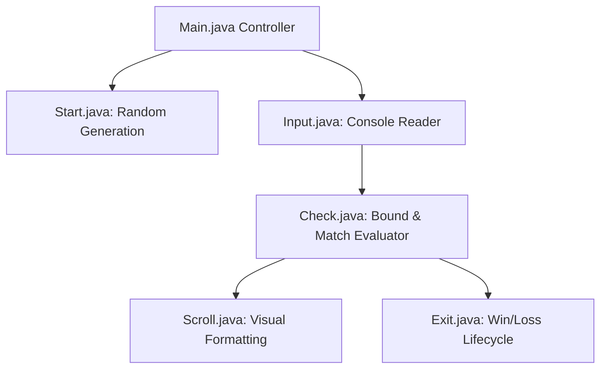

<p align="center">
  
</p>

<p align="center">
   
</p>


## 📌 Table of Contents
- [📖 Executive Summary](#-executive-summary)
- [✨ Key Features & Capabilities](#-key-features--capabilities)
- [🏗️ System Architecture & Workflow](#️-system-architecture--workflow)
- [🛠️ Tech Stack Breakdown](#️-tech-stack-breakdown)
- [⚙️ Reproducible Quickstart & Setup](#️-reproducible-quickstart--setup)
- [📂 Project Directory Layout](#-project-directory-layout)
- [👩‍💻 Author & Contributions](#-author--contributions)

---

## 📖 Executive Summary
### Problem Statement
Console game applications frequently suffer from monolithic code structures where input parsing, state checks, and loop flow are tangled in a single file.

### Motivation & Solution Overview
A modular Java console game that separates distinct responsibilities into dedicated classes: input parsing (`Input.java`), boundary validation (`Check.java`), game initialization (`Start.java`), visual scrolling (`Scroll.java`), and exit lifecycle (`Exit.java`).

---

## ✨ Key Features & Capabilities
- **Separation of Concerns:** Distinct classes for user input, validation, and game loop orchestration.
- **Dynamic Difficulty:** Bounds checking and attempt tracking with user guidance.
- **Robust Exception Handling:** Safe handling of non-numeric console inputs.

---

## 🏗️ System Architecture & Workflow


---

## 🛠️ Tech Stack Breakdown
| Category | Technologies |
|---|---|
| **Language** | Java (JDK 8+) |
| **Design** | Modular Class Architecture, Java Scanner API |

---

## ⚙️ Reproducible Quickstart & Setup
```bash
git clone https://github.com/Bhumikaravi/RandomGuessingGame.git
cd RandomGuessingGame
javac *.java
java Main
```

---

## 📂 Project Directory Layout
```text
RandomGuessingGame/
├── Check.java
├── Exit.java
├── Input.java
├── Main.java
├── Scroll.java
├── Start.java
└── README.md
```

---

## 👩‍💻 Author & Contributions
Developed by **Bhumika Ravi** ([@Bhumikaravi](https://github.com/Bhumikaravi)), Bachelor of Computer Applications (BCA) at **Alliance University, Bengaluru**.

- 💻 **GitHub Profile:** [github.com/Bhumikaravi](https://github.com/Bhumikaravi)
- 🔗 **LinkedIn:** [linkedin.com/in/bhumika-ravi-b5a01b326](https://www.linkedin.com/in/bhumika-ravi-b5a01b326/)
- 📬 **Email Contact:** [bhumikaravi2006@gmail.com](mailto:bhumikaravi2006@gmail.com)

---

<p align="center">
  
</p>
